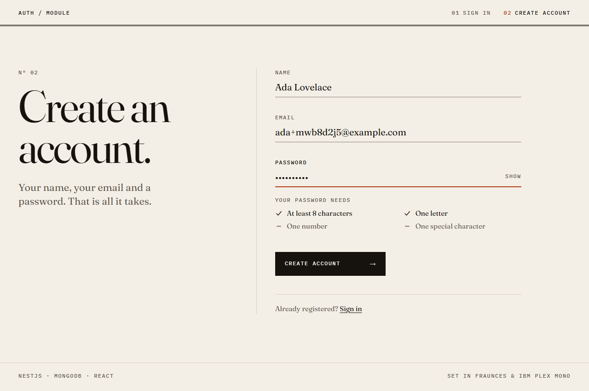
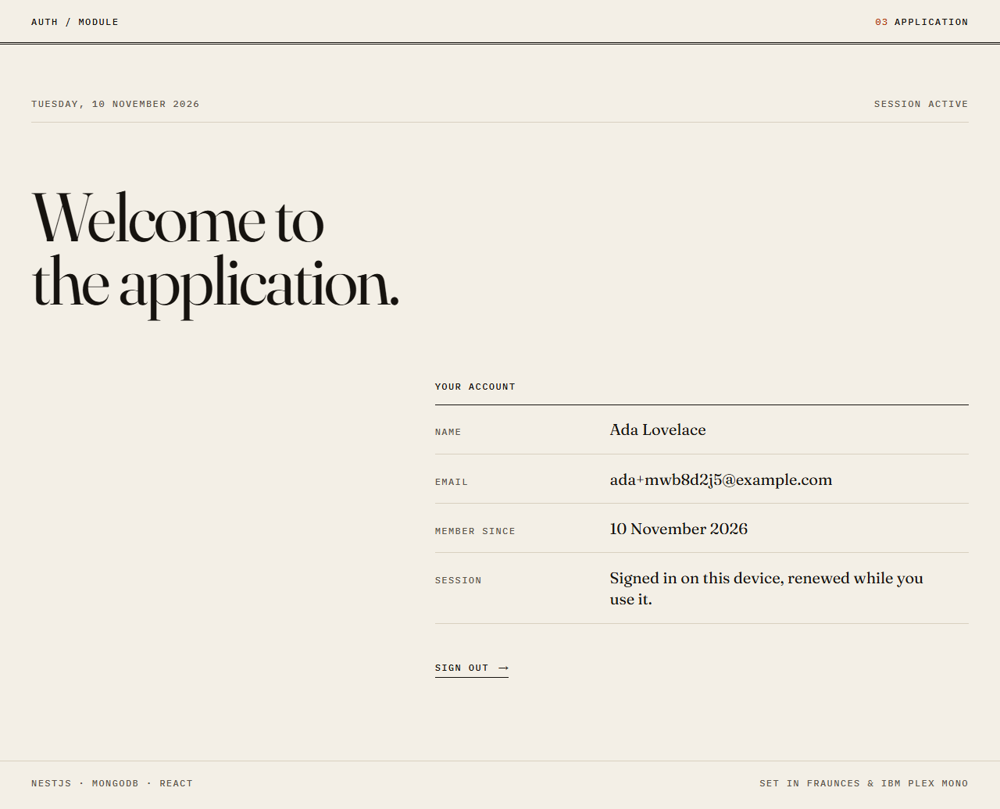
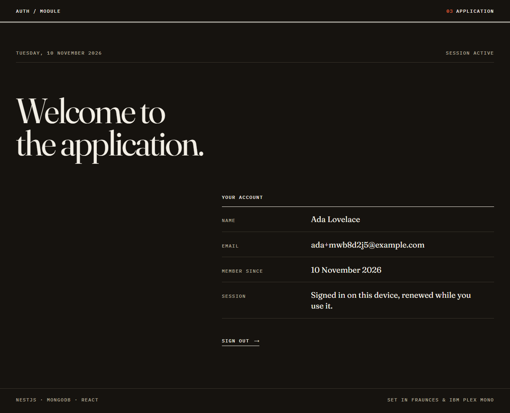
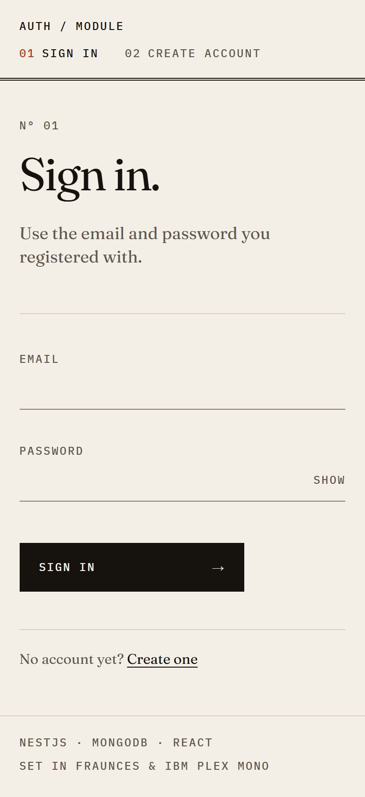

# nest-react-auth

[](https://github.com/Mostafay65/nest-react-auth/actions/workflows/ci.yml)

A sign-up and sign-in module: a React + TypeScript web app on a NestJS + MongoDB API, built for a full-stack take-home task. The task asked for a sign-up form with rules for the email, name and password, a sign-in form, an application page that says "Welcome to the application." with an optional logout, at least one protected endpoint, and code that is ready for production. Logging, error handling, testing, CI/CD and API documentation were bonus items. All five are included.

## What's inside

| Requirement                                                                                                                  | Where                                                                                                                                                                                                                                                           |
| ---------------------------------------------------------------------------------------------------------------------------- | --------------------------------------------------------------------------------------------------------------------------------------------------------------------------------------------------------------------------------------------------------------- |
| Sign-up: a valid email, a name of 3+ characters, a password of 8+ characters with a letter, a number and a special character | [`SignUpForm.tsx`](apps/web/src/features/auth/components/SignUpForm.tsx). The rules are written once in [`packages/contracts`](packages/contracts/src) and enforced by both the form and the API.                                                               |
| Sign-in with email and password                                                                                              | [`SignInForm.tsx`](apps/web/src/features/auth/components/SignInForm.tsx)                                                                                                                                                                                        |
| "Welcome to the application." with a logout button                                                                           | [`WelcomePage.tsx`](apps/web/src/pages/welcome/WelcomePage.tsx)                                                                                                                                                                                                 |
| NestJS + MongoDB                                                                                                             | [`apps/api`](apps/api), with Mongoose behind repository classes                                                                                                                                                                                                 |
| A protected endpoint                                                                                                         | `GET /api/v1/users/me`. Every route needs an access token unless it is marked `@Public()` ([`access-token.guard.ts`](apps/api/src/auth/access-token.guard.ts)).                                                                                                 |
| Logging                                                                                                                      | Structured pino logs with a request ID on every line ([`logger.options.ts`](apps/api/src/common/logging/logger.options.ts))                                                                                                                                     |
| Error handling                                                                                                               | RFC 9457 `application/problem+json` with a stable `code` ([`problem-details.filter.ts`](apps/api/src/common/errors/problem-details.filter.ts)). The web app puts each error on the right field ([`form-errors.ts`](apps/web/src/features/auth/form-errors.ts)). |
| Testing                                                                                                                      | 227 unit and end-to-end tests across the contracts, the API and the web app, 15 browser tests, and a recorded run against the Docker image. See [Tests](#tests).                                                                                                |
| CI/CD                                                                                                                        | GitHub Actions: checks, end-to-end tests, the Docker stack, and images pushed to GHCR ([`ci.yml`](.github/workflows/ci.yml))                                                                                                                                    |
| API documentation                                                                                                            | Swagger UI at `/api/docs`, generated from the same schemas that validate requests ([`swagger.ts`](apps/api/src/common/swagger/swagger.ts))                                                                                                                      |

## Screenshots

| Sign-up, with the live password checklist                                     | The application page                                                       |
| ----------------------------------------------------------------------------- | -------------------------------------------------------------------------- |
|  |  |
| **Dark mode**                                                                 | **Phone**                                                                  |
|            |         |

## Quick start (Docker)

Needs Docker with Compose v2.

```sh
docker compose up -d --build --wait   # or: npm run stack:up
```

| URL                                                                  | What                                                             |
| -------------------------------------------------------------------- | ---------------------------------------------------------------- |
| [http://localhost:8080](http://localhost:8080)                       | The web app                                                      |
| [http://localhost:8080/api/docs](http://localhost:8080/api/docs)     | Swagger UI. The OpenAPI document is at `/api/docs/openapi.json`. |
| [http://localhost:8080/api/health](http://localhost:8080/api/health) | Health check: the API is up and MongoDB answers                  |

nginx serves the web app and proxies `/api` to the API, which has no published port of its own. The compose file is for your own machine: plain HTTP, `COOKIE_SECURE=false` and a throwaway JWT secret (override it with a `JWT_ACCESS_SECRET` environment variable). A real deployment needs TLS, `COOKIE_SECURE=true` and a secret of its own.

Stop it with `docker compose down` (or `npm run stack:down`). Add `--volumes` to delete the database as well.

## Local development

Needs Node 24 (see [`.nvmrc`](.nvmrc)) and Docker for MongoDB.

```sh
npm ci                                    # installs every workspace and builds packages/contracts
npm run db:up                             # MongoDB 8.2 in Docker, on 127.0.0.1:27017
cp apps/api/.env.example apps/api/.env    # local settings; see Configuration below
npm run dev                               # contracts (watch), the API and the web app together
```

| URL                                                                  | What                                              |
| -------------------------------------------------------------------- | ------------------------------------------------- |
| [http://localhost:5173](http://localhost:5173)                       | The web app (Vite). It proxies `/api` to the API. |
| [http://localhost:3000/api/docs](http://localhost:3000/api/docs)     | Swagger UI                                        |
| [http://localhost:3000/api/health](http://localhost:3000/api/health) | Health check                                      |

In development the API logs one readable line per request. In production it logs JSON.

## Configuration

The API reads `apps/api/.env` in development and validates every variable at startup. If one is invalid, it refuses to start and says which one ([`env.ts`](apps/api/src/config/env.ts)).

| Variable                    | Default            | Rule                                                                                                                                               |
| --------------------------- | ------------------ | -------------------------------------------------------------------------------------------------------------------------------------------------- |
| `NODE_ENV`                  | `development`      | `development`, `test` or `production`                                                                                                              |
| `PORT`                      | `3000`             | 1 to 65535                                                                                                                                         |
| `LOG_LEVEL`                 | `info`             | `fatal`, `error`, `warn`, `info`, `debug`, `trace` or `silent`                                                                                     |
| `MONGODB_URI`               | required           | Starts with `mongodb://` or `mongodb+srv://`                                                                                                       |
| `JWT_ACCESS_SECRET`         | required           | At least 32 characters. Generate one with `openssl rand -base64 48`.                                                                               |
| `ACCESS_TOKEN_TTL_SECONDS`  | `900` (15 minutes) | A positive whole number                                                                                                                            |
| `REFRESH_TOKEN_TTL_SECONDS` | `604800` (7 days)  | A positive whole number                                                                                                                            |
| `COOKIE_SECURE`             | `true`             | `true` or `false`. Set `false` only for local runs over plain HTTP.                                                                                |
| `TRUST_PROXY`               | `0`                | The number of reverse proxies in front of the API, so rate limits see the client's real IP                                                         |
| `CORS_ORIGINS`              | empty              | Comma-separated bare origins such as `https://app.example.com`. Empty means same-origin only. They are also trusted by the cross-site write check. |
| `SWAGGER_ENABLED`           | `true`             | `true` or `false`                                                                                                                                  |

## API

| Method | Path                    | Access                          | Success                                         | Errors (`code`)                                                             |
| ------ | ----------------------- | ------------------------------- | ----------------------------------------------- | --------------------------------------------------------------------------- |
| POST   | `/api/v1/auth/sign-up`  | Public, 10 per minute per IP    | 201, a session and the refresh cookie           | 400 `VALIDATION_FAILED`, 409 `EMAIL_ALREADY_REGISTERED`, 429 `RATE_LIMITED` |
| POST   | `/api/v1/auth/sign-in`  | Public, 10 per minute per IP    | 200, a session and the refresh cookie           | 400 `VALIDATION_FAILED`, 401 `INVALID_CREDENTIALS`, 429 `RATE_LIMITED`      |
| POST   | `/api/v1/auth/refresh`  | Refresh cookie                  | 200, a session and a rotated cookie             | 401 `INVALID_REFRESH_TOKEN`                                                 |
| POST   | `/api/v1/auth/sign-out` | Refresh cookie, if any          | 204, the session deleted and the cookie cleared | None: it is safe to call twice                                              |
| GET    | `/api/v1/users/me`      | `Authorization: Bearer <token>` | 200, the user's profile                         | 401 `UNAUTHORIZED`, 404 `NOT_FOUND`                                         |
| GET    | `/api/health`           | Public, not rate-limited        | 200                                             | 503 `SERVICE_UNAVAILABLE`                                                   |

- **A session** is `{ accessToken, tokenType: "Bearer", expiresIn, user: { id, email, name, createdAt } }`. The refresh token never appears in a body. It travels in an `httpOnly`, `SameSite=Strict` cookie limited to `/api/v1/auth`.
- **Rate limits.** Sign-up and sign-in each allow 10 requests per minute per IP. The other routes allow 100, and the health check has no limit. Above the limit the answer is 429 `RATE_LIMITED`.
- **Any request** can also get 403 `FORBIDDEN` (a write sent from another site), 400 `MALFORMED_REQUEST` (a body that is not valid JSON) or 413 `PAYLOAD_TOO_LARGE` (a body over 10 kB).
- **Errors** follow one format, described in [docs/ARCHITECTURE.md](docs/ARCHITECTURE.md#errors).

## Tests

| Suite          | What it proves                                                                                                                                                                                     | Command                                           | Tests |
| -------------- | -------------------------------------------------------------------------------------------------------------------------------------------------------------------------------------------------- | ------------------------------------------------- | ----- |
| Contracts      | The validation rules shared by the API and the web app, including emoji in passwords and MongoDB operators as values                                                                               | `npm test -w @nest-react-auth/contracts`          | 37    |
| API unit       | Every service branch, the guard, the error filter, config and middleware, with in-memory repositories                                                                                              | `npm test -w @nest-react-auth/api`                | 83    |
| API end-to-end | The real app, built by the same `createApp()` as production, against MongoDB (mongodb-memory-server)                                                                                               | `npm run test:e2e`                                | 56    |
| Web unit       | Session restore, refresh and retry, both forms, the welcome page, the route guards, colour contrast                                                                                                | `npm test -w @nest-react-auth/web`                | 51    |
| Browser        | Playwright, through nginx against the Docker stack: the full journey, route guards, form errors, axe scans (WCAG 2.2 AA, light and dark, no sideways scroll at 390px) and a CSP with no violations | `npm run test:browser` (after `npm run stack:up`) | 15    |

- `npm test` runs the contracts, API unit and web suites together. Add coverage with `npm run test:cov -w @nest-react-auth/api` (or `-w @nest-react-auth/web`).
- The first `npm run test:e2e` downloads a MongoDB binary for mongodb-memory-server.
- [docs/E2E_TEST_REPORT.md](docs/E2E_TEST_REPORT.md) records a run against the production Docker image. It calls every endpoint over HTTP (49 calls), checks each response and the matching documents in MongoDB, and compares response times for a wrong password and an unknown email.

## CI/CD

[`ci.yml`](.github/workflows/ci.yml) runs on every push to `main` and on every pull request.

| Job       | What it does                                                                                                                                                                        |
| --------- | ----------------------------------------------------------------------------------------------------------------------------------------------------------------------------------- |
| `checks`  | Format check, lint (oxlint for the API, contracts and browser tests; ESLint for the web app), typecheck, unit tests, build                                                          |
| `api-e2e` | The API end-to-end suite against mongodb-memory-server, with the MongoDB binary cached                                                                                              |
| `stack`   | Builds both images, starts the compose stack, waits for every health check, smoke-tests the app and the API through nginx, then runs the browser suite and uploads its report       |
| `publish` | On `main` only, once the three jobs above pass: pushes `ghcr.io/mostafay65/nest-react-auth-api` and `ghcr.io/mostafay65/nest-react-auth-web`, tagged `latest` and `sha-<short SHA>` |

Dependabot opens weekly updates for npm packages (minor and patch versions grouped), GitHub Actions and the Docker base images.

## Project structure

```
packages/contracts   Zod schemas, password rules and error codes, shared by the API and the web app
apps/api             NestJS API: controllers, services, repositories; its Dockerfile
apps/web             React app; its nginx config and Dockerfile
e2e                  Playwright browser tests
docs                 Architecture guide, end-to-end test report, screenshots
.github              CI workflow and Dependabot
docker-compose.yml   MongoDB, the API and the web app
```

## Design decisions

Each one is explained in [docs/ARCHITECTURE.md](docs/ARCHITECTURE.md).

- **Layers with ports.** Services depend on abstract repository classes and only the Mongoose repositories touch the database, so services are unit-tested with in-memory fakes. ([API layers](docs/ARCHITECTURE.md#api-layers))
- **Two tokens.** A 15-minute JWT kept in memory, and an opaque refresh token in an `httpOnly` cookie that rotates on every use. Reusing an old one ends the session. ([Sessions and tokens](docs/ARCHITECTURE.md#sessions-and-tokens))
- **One error format.** Every error is problem+json with a stable `code`, which the web app uses to place the message. ([Errors](docs/ARCHITECTURE.md#errors))
- **Shared contracts.** One set of Zod schemas validates requests, generates the OpenAPI document, and drives the web forms and the password checklist. ([System](docs/ARCHITECTURE.md#system))
- **Secure by default.** Routes need a token unless marked `@Public()`, configuration is checked at startup, sign-in is rate-limited and takes as long for an unknown email as for a wrong password, and the API and web containers run as non-root users. ([Security](docs/ARCHITECTURE.md#security))
- **One origin.** nginx serves the app and proxies `/api`, so the refresh cookie is first-party and CORS stays off. ([System](docs/ARCHITECTURE.md#system))
- **An editorial UI without a component kit.** CSS Modules over light and dark tokens, a test that checks WCAG AA contrast, and focus handling for keyboard and screen reader users. ([Web app](docs/ARCHITECTURE.md#web-app))

## Trade-offs and next steps

- **Strict reuse detection.** A refresh token presented twice ends the session, even after a harmless race. The web client sends one refresh at a time to avoid that.
- **In-memory rate limits.** They count per API instance. Several instances would need a shared store such as Redis.
- **Not built:** email verification, password reset, MFA and "sign out everywhere".

More in [docs/ARCHITECTURE.md](docs/ARCHITECTURE.md#trade-offs-and-next-steps).
