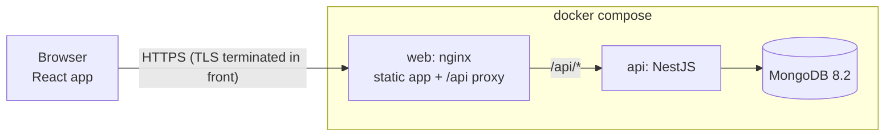
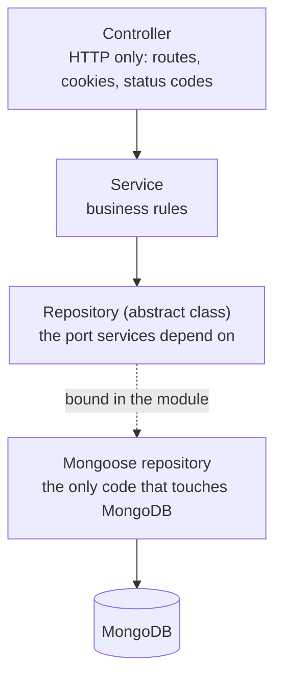
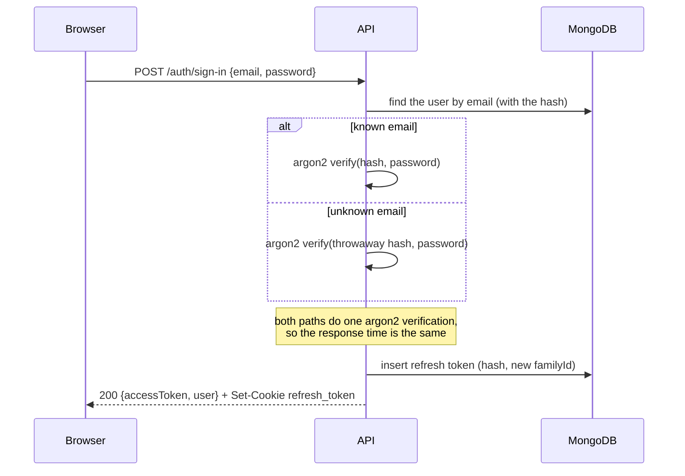
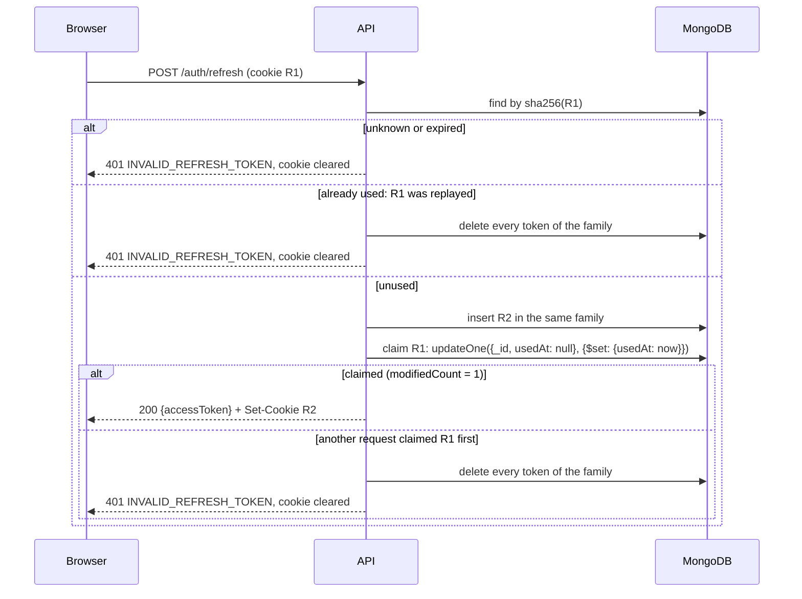

# Architecture

How the pieces fit together, and why they are built this way. For setup and commands, see the [README](../README.md).

- [System](#system)
- [Repository layout](#repository-layout)
- [API layers](#api-layers)
- [Request lifecycle](#request-lifecycle)
- [Sessions and tokens](#sessions-and-tokens)
- [Data model](#data-model)
- [Errors](#errors)
- [Security](#security)
- [Logging](#logging)
- [Web app](#web-app)
- [Testing](#testing)
- [Trade-offs and next steps](#trade-offs-and-next-steps)

## System



- **One origin.** nginx serves the built web app and proxies `/api` to the API. The refresh cookie is therefore first-party, and no CORS is needed. CORS can still be switched on for other clients (`CORS_ORIGINS`).
- **Shared contracts.** [`packages/contracts`](../packages/contracts) holds the Zod schemas, the password rules and the error codes. The API validates requests with them and generates its OpenAPI document from them. The web app validates its forms with the same schemas, so client and server can't drift apart.

## Repository layout

```
packages/contracts   Zod schemas, password rules, error codes (shared)
apps/api             NestJS API
  src/auth           sign-up, sign-in, tokens, refresh token rotation
  src/users          the user record and the protected profile route
  src/common         cross-cutting: errors, validation, logging, HTTP, Swagger
  src/config         environment validation
  src/health         MongoDB health check
  test/              end-to-end tests, in-memory fakes, test setup
apps/web             React app (Vite), and its nginx image
e2e                  Playwright browser tests
docs                 this file, the end-to-end test report
```

## API layers



| Layer                                                                                                      | Knows about                                     | Never touches            |
| ---------------------------------------------------------------------------------------------------------- | ----------------------------------------------- | ------------------------ |
| Controller ([`auth.controller.ts`](../apps/api/src/auth/auth.controller.ts))                               | HTTP: bodies, cookies, status codes, API docs   | MongoDB, hashing, tokens |
| Service ([`auth.service.ts`](../apps/api/src/auth/auth.service.ts))                                        | the rules: who may sign in, when a session ends | HTTP, Mongoose           |
| Repository port ([`users.repository.ts`](../apps/api/src/users/users.repository.ts))                       | the operations the domain needs                 | how they are stored      |
| Mongoose repository ([`mongoose-users.repository.ts`](../apps/api/src/users/mongoose-users.repository.ts)) | documents, indexes, duplicate-key errors        | HTTP, business rules     |

- **Ports are abstract classes.** An abstract class is also a Nest DI token, so a module binds the port to its adapter in one line: `{ provide: UsersRepository, useClass: MongooseUsersRepository }`. Unit tests construct services with in-memory fakes ([`test/fakes`](../apps/api/test/fakes)) and need no database or Nest container.
- **Repositories return plain objects** (`User`, `StoredRefreshToken`), never Mongoose documents. Nothing above them depends on Mongoose.
- **Services throw domain errors** (`EmailAlreadyRegisteredError`, `InvalidCredentialsError`…), never HTTP exceptions. One global filter maps them to HTTP. The services would work the same behind a queue or a CLI.

## Request lifecycle

What happens to a request, in order ([`app.setup.ts`](../apps/api/src/app.setup.ts), [`app.module.ts`](../apps/api/src/app.module.ts)):

1. **Request ID.** A caller's `X-Request-Id` is kept if it is short and log-safe. Otherwise a UUID is generated. The ID is echoed in the response header and the error body, and appears on every log line.
2. **Security headers.** CSP, HSTS, `X-Content-Type-Options` and the rest, via Nest's built-in `useSecurityHeaders()`.
3. **Cross-site write check.** Nest's `enableCsrfProtection()` rejects a state-changing request whose `Sec-Fetch-Site` says another site sent it. When the browser doesn't send `Sec-Fetch-Site`, it compares `Origin` with `Host`.
4. **CORS**, when origins are configured.
5. **JSON body** of at most 10 kB. Nothing else is parsed.
6. **Request log** (pino-http).
7. **Guards**, in this order:
   - the rate limit (per client IP);
   - the access token. Every route needs a valid token unless it is marked `@Public()`, so a new route is protected by default.
8. **Validation.** `@Body({ schema })` validates against a contract schema, which also trims and lower-cases where needed. Unknown fields are rejected, not dropped.
9. **Controller → service → repository.**
10. **Errors.** Every exception, from any step, goes through [`ProblemDetailsFilter`](../apps/api/src/common/errors/problem-details.filter.ts).

## Sessions and tokens

|                 | Access token                                             | Refresh token                                                                             |
| --------------- | -------------------------------------------------------- | ----------------------------------------------------------------------------------------- |
| Form            | JWT, HS256, with `iss`, `aud` and a random `jti`         | 256 random bits, base64url, opaque                                                        |
| Lifetime        | 15 minutes                                               | 7 days, renewed on every refresh                                                          |
| Travels in      | the response body, then `Authorization: Bearer`          | an `httpOnly`, `SameSite=Strict` cookie, `Path=/api/v1/auth`, `Secure` outside local HTTP |
| Client keeps it | in memory only                                           | the browser keeps it; scripts can't read it                                               |
| Server stores   | nothing                                                  | the SHA-256 hash only, with its session (`familyId`) and `usedAt`                         |
| Verification    | signature, algorithm, issuer, audience and expiry pinned | hash lookup, then expiry, then an atomic "claim"                                          |

**Why this split.** The short-lived access token is never stored by the browser, so an XSS bug can't take it away for later use. The refresh token can't be read by scripts at all. `SameSite=Strict` plus the cross-site write check stop other sites from using it. Its path keeps it off every request except the auth routes.

### Sign-in



A wrong password and an unknown email get the same answer, in the same time: about 35 ms each in the [live run](E2E_TEST_REPORT.md#timing).

### Refresh, rotation and reuse detection



- **Rotation.** Every refresh retires the presented token and issues its successor in the same family (one family per sign-in).
- **Reuse detection** ([RFC 9700 §4.14.2](https://www.rfc-editor.org/rfc/rfc9700#section-4.14.2)). A retired token can only come back if someone copied it. The API then ends the whole family, so neither the thief nor the user can go on, and the user signs in again. Other sessions (other devices) are untouched.
- **A race ends the session too.** Only one `updateOne` can match `usedAt: null`, so of two requests with the same token, one wins and the other counts as reuse. The successor is stored before the claim, so that revocation also removes the token the winner received, whichever request finishes first. Unit tests force both orders, and an end-to-end test runs the race against MongoDB.
- **Forged tokens are harmless.** Lookup is by hash, so a made-up token matches nothing and revokes nothing.
- **Clean-up.** A TTL index removes expired tokens.

### Sign-out

`POST /auth/sign-out` deletes the token's family and clears the cookie. It answers 204 even without a cookie, so it is safe to call twice.

## Data model

**`users`**

| Field                    | Type     | Notes                                                                                          |
| ------------------------ | -------- | ---------------------------------------------------------------------------------------------- |
| `_id`                    | ObjectId |                                                                                                |
| `email`                  | string   | trimmed, lower-cased, at most 254 characters, **unique index**                                 |
| `name`                   | string   | trimmed, 3–50 characters (checked at the edge)                                                 |
| `passwordHash`           | string   | argon2id, 19 MiB, 2 passes, 1 lane. `select: false`: left out of every query unless asked for. |
| `createdAt`, `updatedAt` | Date     |                                                                                                |

The unique index is what makes sign-up safe under races: two simultaneous sign-ups with one email produce one account and one 409. The end-to-end suite tests exactly that.

**`refresh_tokens`**

| Field       | Type          | Notes                                                                    |
| ----------- | ------------- | ------------------------------------------------------------------------ |
| `_id`       | ObjectId      |                                                                          |
| `familyId`  | string (UUID) | one per sign-in; **indexed**, for revoking a session                     |
| `userId`    | ObjectId      |                                                                          |
| `tokenHash` | string        | SHA-256 of the token, **unique index**; the token itself is never stored |
| `expiresAt` | Date          | **TTL index** (`expireAfterSeconds: 0`)                                  |
| `usedAt`    | Date or null  | set when the token is exchanged                                          |
| `createdAt` | Date          |                                                                          |

## Errors

Every error is an [RFC 9457](https://www.rfc-editor.org/rfc/rfc9457) `application/problem+json` body. Clients branch on `code`, never on the text.

```json
{
  "type": "about:blank",
  "title": "Bad Request",
  "status": 400,
  "detail": "The request is invalid. See `errors` for each field.",
  "instance": "/api/v1/auth/sign-up",
  "code": "VALIDATION_FAILED",
  "requestId": "b0b5c3f6-0f8e-4f0c-9d6c-3c1f4b7a2e10",
  "errors": [{ "field": "password", "message": "Password must contain at least one number" }]
}
```

| `code`                     | Status | When                                                                                  |
| -------------------------- | ------ | ------------------------------------------------------------------------------------- |
| `VALIDATION_FAILED`        | 400    | a field breaks a rule. `errors` lists every failure at once.                          |
| `MALFORMED_REQUEST`        | 400    | the body is not valid JSON, or the request is otherwise unreadable                    |
| `EMAIL_ALREADY_REGISTERED` | 409    | sign-up with a registered email                                                       |
| `INVALID_CREDENTIALS`      | 401    | sign-in with a wrong password or an unknown email (one answer for both)               |
| `INVALID_REFRESH_TOKEN`    | 401    | the refresh cookie is missing, unknown, expired, or was already used                  |
| `UNAUTHORIZED`             | 401    | no access token, or one that fails verification; sent with `WWW-Authenticate: Bearer` |
| `FORBIDDEN`                | 403    | a cross-site write                                                                    |
| `NOT_FOUND`                | 404    | an unknown route, or a user deleted after their token was issued                      |
| `PAYLOAD_TOO_LARGE`        | 413    | a body over 10 kB                                                                     |
| `RATE_LIMITED`             | 429    | too many requests; sent with `Retry-After`                                            |
| `SERVICE_UNAVAILABLE`      | 503    | the health check failed                                                               |
| `INTERNAL_ERROR`           | 500    | anything unexpected. The details go to the log, never to the client.                  |

## Security

| Threat                                  | Defence                                                                                                                    | Where                                                                                                                                                           |
| --------------------------------------- | -------------------------------------------------------------------------------------------------------------------------- | --------------------------------------------------------------------------------------------------------------------------------------------------------------- |
| Stolen password database                | argon2id at OWASP's minimum cost; refresh tokens stored as SHA-256 hashes                                                  | [`password-hasher.ts`](../apps/api/src/auth/password-hasher.ts), [`refresh-token.crypto.ts`](../apps/api/src/auth/refresh-tokens/refresh-token.crypto.ts)       |
| Account enumeration through sign-in     | one answer for a wrong password and an unknown email, and an argon2 verification on both paths                             | [`auth.service.ts`](../apps/api/src/auth/auth.service.ts)                                                                                                       |
| Password guessing                       | sign-in and sign-up each allow 10 requests per minute per client IP (other routes: 100)                                    | [`api.constants.ts`](../apps/api/src/common/http/api.constants.ts)                                                                                              |
| Forged or tampered access tokens        | HS256 only; issuer, audience and expiry checked; `alg: none` refused                                                       | [`jwt.options.ts`](../apps/api/src/auth/jwt.options.ts)                                                                                                         |
| Stolen refresh token                    | rotation with reuse detection; `httpOnly`; narrow cookie path                                                              | [`refresh-token.service.ts`](../apps/api/src/auth/refresh-tokens/refresh-token.service.ts)                                                                      |
| CSRF                                    | `SameSite=Strict`, plus the `Sec-Fetch-Site`/`Origin` check on every write                                                 | [`app.setup.ts`](../apps/api/src/app.setup.ts)                                                                                                                  |
| NoSQL injection                         | schemas accept strings only; Mongoose `sanitizeFilter` on every query                                                      | [`auth.ts`](../packages/contracts/src/auth.ts), [`database.module.ts`](../apps/api/src/database/database.module.ts)                                             |
| Mass assignment                         | unknown fields are rejected (`z.strictObject`)                                                                             | [`auth.ts`](../packages/contracts/src/auth.ts)                                                                                                                  |
| Oversized or malformed bodies           | JSON only, 10 kB limit, clean 400/413 answers                                                                              | [`app.setup.ts`](../apps/api/src/app.setup.ts)                                                                                                                  |
| Token theft through XSS                 | the access token lives in memory only, the refresh token is `httpOnly`, and nginx sends a strict CSP (`script-src 'self'`) | [`session-store.ts`](../apps/web/src/features/auth/session-store.ts), [`security-headers.conf`](../apps/web/nginx/security-headers.conf)                        |
| Leaking internals                       | generic 500s; headers (and so tokens and cookies) never logged                                                             | [`problem-details.filter.ts`](../apps/api/src/common/errors/problem-details.filter.ts), [`logger.options.ts`](../apps/api/src/common/logging/logger.options.ts) |
| Bad configuration reaching production   | every variable validated at startup; the process refuses to start otherwise                                                | [`env.ts`](../apps/api/src/config/env.ts)                                                                                                                       |
| Vulnerable or overprivileged containers | non-root users; no package managers in the API image; 0 HIGH/CRITICAL findings (Trivy)                                     | [`apps/api/Dockerfile`](../apps/api/Dockerfile), [`apps/web/Dockerfile`](../apps/web/Dockerfile)                                                                |

## Logging

- **pino**: one JSON line per request in production, one readable line in development.
- **What each request line holds:** `req.id`, method, URL, client IP (through `TRUST_PROXY`), status and duration. Headers are never logged, so tokens and cookies can't leak into logs.
- **Request context.** Log lines written by services during a request carry the same `req.id`, through nestjs-pino's async context. This line is from the [live run](E2E_TEST_REPORT.md), without its `time`, `pid` and `hostname`:
  ```json
  {
    "level": 40,
    "req": {
      "id": "b389f9d3-06b2-4688-8676-e6dc32beeb6b",
      "method": "POST",
      "url": "/api/v1/auth/refresh",
      "ip": "::ffff:172.20.0.1"
    },
    "context": "RefreshTokenService",
    "familyId": "68f7255f-c44e-4032-a66f-8c3a14a6e494",
    "userId": "6af38919a86f5f0be43d328f",
    "msg": "Refresh token reuse detected; session revoked"
  }
  ```
- **Requests rejected before routing** (invalid JSON, oversized bodies, cross-site writes) never reach the request logger. The error filter logs them instead, so every request leaves a trace.
- **Health checks are not logged.** Container health probes would drown everything else.

## Web app

```
src/app        router, route table, the page frame
src/features   auth: session, guards, API calls, forms · profile: GET /users/me
src/pages      sign-in, sign-up, welcome, not found, error, boot
src/shared     HTTP client, design tokens, UI components
```

- **The session lives in memory** ([`session-store.ts`](../apps/web/src/features/auth/session-store.ts)), read by components through `useSyncExternalStore`. Nothing goes to `localStorage`. A reload restores the session with one refresh call, using the cookie.
- **Guards are route middleware** ([`guards.ts`](../apps/web/src/features/auth/guards.ts)). They run top-down before any loader. The root settles the session once per page load, `/app` requires a session, and the sign-in and sign-up pages send a signed-in user to `/app`. Because the boot refresh runs in middleware rather than in an effect, React's StrictMode can't send it twice.
- **One refresh at a time** ([`session.ts`](../apps/web/src/features/auth/session.ts)). Callers in a tab share one request, and tabs take turns through a Web Lock, each sending the cookie the previous tab received. A legitimate user therefore never trips reuse detection.
- **A 401 gets one retry** ([`authorized-request.ts`](../apps/web/src/features/auth/authorized-request.ts)). When the access token has expired, the client refreshes and repeats the call once. If the session is over, the user is sent to sign in.
- **Every response is checked** against the contract schemas, and errors are parsed as problem details. A body that doesn't match becomes an `UNEXPECTED_RESPONSE` error instead of bad data on screen.
- **Server errors land where the user looks** ([`form-errors.ts`](../apps/web/src/features/auth/form-errors.ts)). `EMAIL_ALREADY_REGISTERED` and `VALIDATION_FAILED` go on their fields. Everything else becomes one message above the button. Focus moves to the first problem.
- **Sign-out asks the server first.** If that call fails, the user stays signed in and is told so. Clearing only the browser's memory would leave a cookie that signs them back in on the next reload.
- **Design:** paper and ink, with one vermilion accent kept for errors, focus and the current page. Colours are CSS variables for light and dark ([`tokens.css`](../apps/web/src/shared/styles/tokens.css)), and a unit test checks every text and control pair against WCAG AA. The fonts (Fraunces and IBM Plex Mono) are bundled, not loaded from a CDN, so the strict CSP holds.

## Testing

| Level          | What it proves                                                                      | Tools                                    |
| -------------- | ----------------------------------------------------------------------------------- | ---------------------------------------- |
| Contracts      | every validation rule, including emoji in passwords and MongoDB operators as values | Vitest                                   |
| API unit       | every branch of every service, the guard, the error filter, config, middleware      | Vitest, in-memory repository fakes       |
| API end-to-end | the real app, built by the same `createApp()` as production, against a real MongoDB | Vitest, supertest, mongodb-memory-server |
| Live run       | the production Docker image against MongoDB 8.2, recorded call by call              | [E2E test report](E2E_TEST_REPORT.md)    |
| Web unit       | the session, refresh and retry logic, both forms, the route guards, colour contrast | Vitest, Testing Library, MSW             |

## Trade-offs and next steps

- **No refresh grace period.** A token presented twice ends the session, even when the cause is two tabs refreshing at the same moment rather than theft. The strict rule is the safer default, and the web client avoids the race by refreshing one tab at a time. A short grace window would trade some of that safety for tolerance of flaky networks.
- **A sliding session.** An active user stays signed in indefinitely. An absolute limit (for example, 30 days since sign-in) would go on the family.
- **409 on sign-up.** Telling a person that their email is already registered is what the form needs, but it reveals that the account exists. The rate limit slows enumeration. Email verification with a neutral answer would close it.
- **Per-IP limits only.** Rate limits live in memory, so they are per instance. Running several API instances would need a shared store (Redis) for the throttler, and per-account lockout would complement the per-IP limit.
- **Not built:** email verification, password reset, MFA, and "sign out everywhere". With `familyId` and `userId` already on every token, "sign out everywhere" is one `deleteMany`.
